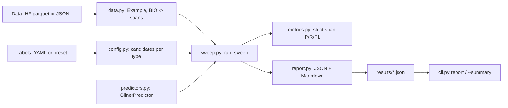

# labelsweep: Implementation

Reference for how the tool works, how to run and extend it, and how the study is reproduced.
Version 0.1.0. See [PROJECT_PLAN.md](PROJECT_PLAN.md) for scope and schedule.

## 1. Architecture



| Module | Responsibility | Key names |
|---|---|---|
| `data.py` | Examples, BIO decoding, JSONL and Hugging Face parquet loaders | `Example`, `bio_to_spans`, `load_jsonl`, `load_hf`, `BENCHMARKS` |
| `metrics.py` | Strict span matching and aggregation | `PRF`, `Scores`, `counts`, `score` |
| `sweep.py` | Candidate validation, wording variants, coordinate sweep, bootstrap | `run_sweep`, `SweepResult`, `paired_bootstrap`, `auto_variants`, `pluralize` |
| `predictors.py` | Model adapters; character-offset to token-span mapping | `GlinerPredictor`, `char_to_token_spans`, `join_tokens` |
| `config.py` | Label files and bundled presets | `load_labels`, `list_presets` |
| `report.py` | Result serialisation, per-run and cross-run reports | `to_dict`, `markdown`, `summarize`, `summary_table` |
| `cli.py` | `run`, `report`, `presets` commands; input validation | `main`, `expand_paths` |
| `presets/*.yaml` | Pre-registered candidate wordings per benchmark | generated by `scripts/make_presets.py` |

Runtime dependencies are `pyarrow` and `pyyaml`. The `gliner` extra adds `gliner`, `torch` and `protobuf`.

## 2. Data model

**Span:** `(start, end, type)`, token indices, end-exclusive.

**JSONL input** (one example per line):
```json
{"tokens": ["Hinton", "works", "at", "Google"], "spans": [[0, 1, "researcher"], [3, 4, "organisation"]]}
```

**Hugging Face benchmarks** are read from the parquet export
(`https://huggingface.co/api/datasets/<id>/parquet/<config>/<split>`), so the deprecated
`datasets` loading scripts are not needed. Tag names come from the datasets-server `/info` endpoint, or from
`dataset/label.json` for `tner/*` datasets. The tag column is `ner_tags` or `tags`. Files are cached in
`~/.cache/labelsweep` (override with `LABELSWEEP_CACHE`).

| Name | Source | Dev (validation) | Test |
|---|---|---|---|
| `crossner_ai` | DFKI-SLT/cross_ner, ai | 350 | 431 |
| `crossner_literature` | DFKI-SLT/cross_ner, literature | 400 | 416 |
| `crossner_music` | DFKI-SLT/cross_ner, music | 380 | 465 |
| `crossner_politics` | DFKI-SLT/cross_ner, politics | 541 | 651 |
| `crossner_science` | DFKI-SLT/cross_ner, science | 450 | 543 |
| `mit_restaurant` | tner/mit_restaurant | 760 | 1521 |
| `mit_movie` | tner/mit_movie_trivia | loader only, no preset | |

**BIO decoding** follows the conlleval convention: a stray `I-` tag starts a new span, and a type change
ends the current span.

## 3. Label candidates

YAML maps each gold type to a list of wordings; the first wording is the default:
```yaml
researcher: [researcher, scientist, academic]
person: [person]   # with --auto: person, Person, persons, person name
```
- `validate_candidates` rejects a wording assigned to two types in the same file, because the model output
  could not be mapped back to a single type.
- `auto_variants(w)` returns `w`, lowercase, Title Case, plural (via `pluralize`), and `"<w> name"`, without
  duplicates. `pluralize` handles `-y -> -ies`, sibilants (`-es`), and returns `None` for adjectives ending in
  `-ous` (for example, "miscellaneous").
- Bundled presets (`preset:<name>`) are generated by `scripts/make_presets.py`. Per type: natural default,
  two hand-written alternatives, the raw dataset tag if different, a casing variant and the plural.

## 4. Sweep algorithm

`run_sweep(dev, test, candidates, predictor)`:

1. Validate candidates. `defaults[t] = candidates[t][0]`.
2. **Coordinate sweep.** For each type `t` and each wording `w`, build the label set
   `{**defaults, t: w}`, predict on dev and test together, map predicted wordings back to gold types, and score
   both splits. Store `dev_type_f1`, `test_type_f1`, `dev_micro_f1` and `test_micro_f1` per wording.
3. **Selection on dev only.** `best[t]` is the wording with the highest `dev_type_f1`; ties keep the earlier
   wording, so the default wins ties.
4. **Joint evaluation.** Score the default set and the selected set on both splits.
5. **Uncertainty.** Paired bootstrap over test sentences (1000 resamples, seed 0) of
   `micro_F1(best) - micro_F1(default)`; report the 2.5th and 97.5th percentiles.

**Caching.** Predictions are cached per ordered label tuple. Model passes over dev and test:

```
n_label_sets = 1 + sum_t (k_t - 1) + [best != defaults]
```

where `k_t` is the number of wordings for type `t`. For example, crossner_ai has 14 types and 72 wordings,
which gives 1 + 58 + 1 = 60 passes, matching `n_label_sets` in the result file.

**Interface for predictors** (`sweep.Predictor`):
```python
def predict(self, token_lists: list[list[str]], labels: list[str]) -> list[list[tuple[int, int, str]]]:
    """Spans per example, typed with the label wording that was passed in."""
```
Spans whose label is not in the current set are dropped.

## 5. GLiNER adapter

- Tokens are joined with single spaces (`join_tokens` records each token's character start and end).
- `GLiNER.inference(texts, labels, flat_ner=True, threshold, batch_size)` returns character offsets.
- `char_to_token_spans` maps offsets back to tokens. Offsets inside a token snap outward to the containing
  token, and duplicate spans created by snapping are removed.
- Device: CUDA if available, otherwise CPU. Inference runs under `torch.inference_mode()`. Defaults: threshold
  0.5, batch size 16.

## 6. Metrics

- **Strict span match:** a prediction is a true positive only when start, end and type all match.
- **Per-type** P/R/F1 from summed counts. **Micro** over all candidate types. **Macro** is the mean of per-type F1.
- An F1 with no true positives is 0 (no division error).
- **Support** is the number of gold spans per type (`tp + fn` under the default label set).

## 7. Reports

**Per run** (`labelsweep report file.json`): for each type, test support, default wording, F1 at default,
minimum, maximum, spread, the dev-chosen wording and its test F1. Types with fewer than `--min-support`
(default 30) test spans are marked "(small)" and excluded from the aggregates below.

**Aggregates** (`summarize`):
| Field | Definition |
|---|---|
| `median_spread` | median over supported types of (max - min) test per-type F1 across that type's wordings |
| `median_trivial_spread` | median over supported types of the largest absolute change from the default caused by a casing or plural variant (`is_trivial_variant`) |
| `micro_range` | max - min test micro-F1 over all coordinate label sets (all types) |

**Cross-run** (`labelsweep report results --summary`): one row per result with the aggregates, default
micro-F1, test gain with CI, and dev gain.

**Result JSON schema** (top-level keys): `defaults`, `best_labels`, `per_type` (list of wording rows per
type), `dev` and `test` (each with `default` and `best` scores: `micro_p`, `micro_r`, `micro_f1`, `macro_f1`,
`per_type_f1`), `test_gain_ci95`, `support` (`dev`, `test`), `n_dev`, `n_test`, `n_label_sets`, and `meta`
(`data`, `labels`, `auto`, `model`, `threshold`, `seconds`, `timestamp`, `versions`).

## 8. Command reference

| Command | Purpose |
|---|---|
| `labelsweep presets` | List bundled presets and their sources |
| `labelsweep run <name> [--model M]` | Sweep a bundled benchmark with its preset |
| `labelsweep run DEV.jsonl,TEST.jsonl --labels FILE [--auto]` | Sweep your own data |
| `labelsweep report <files, globs or directory> [--summary] [--min-support N]` | Print reports |

`run` options: `--threshold` (0.5), `--batch-size` (16), `--dev-limit`, `--test-limit`, `--bootstrap` (1000),
`--out`, `--force`. `run` validates the label and data paths before loading a model, and refuses to
overwrite an existing result file without `--force`. `report` expands globs and directories itself, because
PowerShell and cmd pass `*.json` through unexpanded.

Exit codes: 0 success; 2 usage or input error (one-line message on stderr).

## 9. Development environment

```bash
# uv: https://docs.astral.sh/uv/
uv sync --extra gliner        # Windows: torch comes from the cu128 index (pyproject [tool.uv.sources])
uv run pytest -q
uv run ruff check . && uv run ruff format --check .
```

Platform notes observed during development:
| Issue | Resolution |
|---|---|
| PyPI torch wheels on Windows are CPU-only | `[tool.uv.sources] torch` uses the `pytorch-cu128` index on `win32` (RTX 50-series needs cu128 or later) |
| DeBERTa-v3 tokenizers fail under transformers 5 without protobuf | `protobuf` is in the `gliner` extra |
| Windows Application Control may block `.venv/Scripts/labelsweep.exe` | use `python -m labelsweep` |
| `uv init` set `requires-python >= 3.14` | set to `>= 3.10` |
| Line endings | `.gitattributes`: `* text=auto eol=lf` |

## 10. Testing

| File | Covers |
|---|---|
| `tests/test_data_metrics.py` | BIO decoding edge cases; strict span scoring; empty input |
| `tests/test_sweep.py` | selection on dev, spread, caching count, duplicate-wording rejection, variants, pluralisation, bootstrap |
| `tests/test_predictors.py` | token joining offsets, exact and mid-token offset mapping, deduplication |
| `tests/test_report.py` | trivial-variant rule, support filtering, summary rows, "n/a" when no type is supported |
| `tests/test_cli.py` | end-to-end `run` and `report` with a fake predictor, glob/directory expansion, clean errors, no overwrite, bundled presets valid, bundled example valid |

Tests use fake predictors, so CI does not install torch or download models. Status: 27 tests pass on Python
3.12 (with GPU stack) and 3.10 (core only).

## 11. Reproducing the study

```bash
uv sync --extra gliner
python scripts/make_presets.py         # optional: regenerates the bundled presets (no changes expected)
python scripts/run_grid.py             # 6 datasets x 3 GLiNER v2.1 sizes; skips existing results
labelsweep report results --summary
```
Pinned versions in the 2026-11-14 run: gliner 0.2.30, torch 2.11.0+cu128, transformers 5.22.2, Python 3.12.13,
GPU RTX 5070 12 GB. Inference is deterministic for fixed inputs: an independent rerun reproduced every score.

## 12. Extending: adding a backend

1. Implement the `Predictor` interface in `predictors.py`:
```python
class MyPredictor:
    def __init__(self, model: str, threshold: float = 0.5):
        ...
    def predict(self, token_lists, labels):
        # return [[(start_tok, end_tok, label_wording), ...] for each example]
        ...
```
2. Use `join_tokens` and `char_to_token_spans` if the model returns character offsets.
3. Select the backend in `cli.make_predictor` (planned: a `--backend` option, backlog B1).
4. Add a unit test for offset mapping with that model's output format; keep model-loading tests out of CI.

## 13. Known limitations

- The coordinate sweep does not search type interactions; the final label set is evaluated jointly.
- Alternative wordings are hand-written by one author (mitigation planned in backlog B3).
- Fixed threshold 0.5; wording effects may interact with the threshold (backlog B2).
- GLiNER may have seen similar label strings during training (Golde et al., 2025).
- Strict matching penalises boundary differences that a lenient metric would accept.
